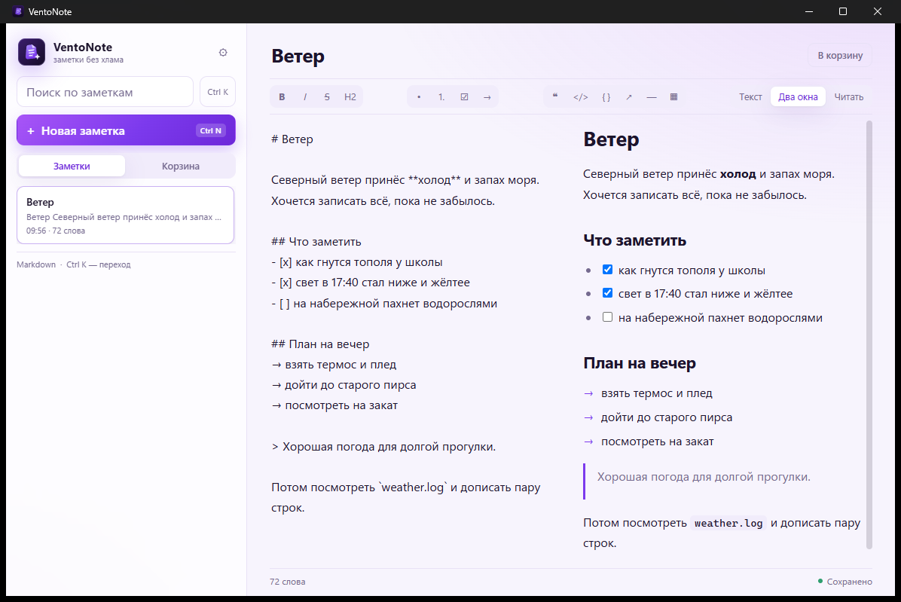
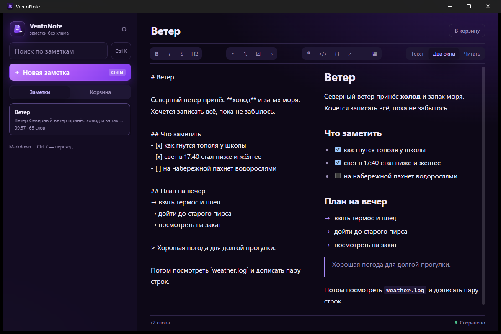
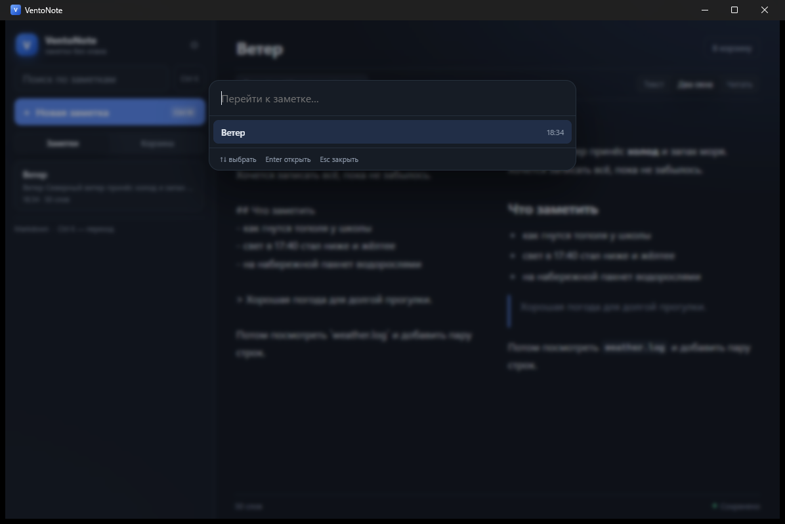
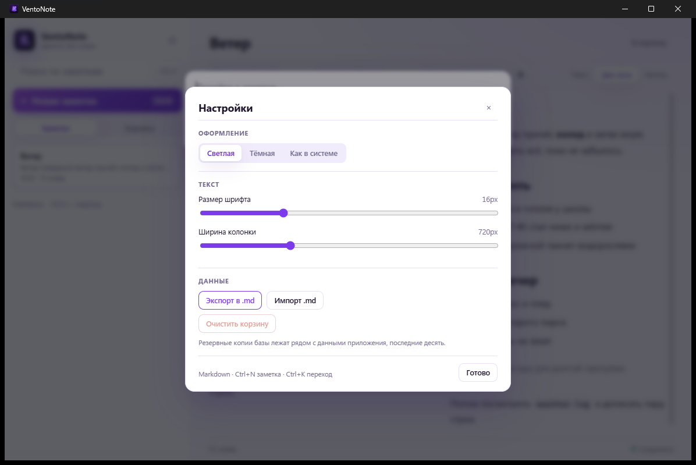

# VentoNote

Заметки без хлама. Локальное приложение на Tauri в фиолетовой гамме нового
логотипа: markdown-редактор с чек-листами и стрелками, мгновенный поиск по
словоформам, корзина вместо необратимого удаления и автоматические резервные
копии. Всё хранится в SQLite на вашем компьютере.



<details>
<summary>Тёмная тема, палитра и настройки</summary>





</details>

## Что умеет

**Писать**
- markdown с живым предпросмотром: режимы «Текст», «Два окна», «Читать»;
- **чек-листы**: `- [ ]` превращается в настоящий чекбокс, по нему можно
  кликнуть прямо в предпросмотре — разметка обновится сама;
- **стрелочные списки**: строки с `→`, `⇒`, `★`, `✓` рендерятся списком с этим
  маркером;
- тулбар на все случаи: жирный, курсив, зачёркнутый, заголовок, маркированный
  и нумерованный список, чек-лист, стрелка, цитата, код, блок кода, ссылка,
  разделитель и таблица;
- автосохранение через 450 мс, плюс сохранение при смене заметки, потере фокуса
  и **при закрытии окна** — последние нажатия не теряются;
- счётчик слов и индикатор «Сохранено / Сохраняю…».

**Находить**
- полнотекстовый поиск FTS5 по заголовку и тексту;
- префиксный поиск: «замет» находит «заметка», «заметки», «заметкам»;
- палитра `Ctrl+K` — переход к заметке с клавиатуры.

**Не терять**
- корзина с восстановлением и окончательным удалением;
- автобэкап базы раз в час, хранятся последние 10 копий;
- экспорт всех заметок в отдельные `.md`-файлы и импорт обратно;
- ошибки сохранения показываются уведомлением, а текст остаётся в очереди;
- закрытие окна сначала дописывает несохранённое (с таймаутом 2 с) и только
  потом закрывает приложение — висящих процессов не остаётся;
- одно окно на всех: повторный запуск поднимает уже открытое приложение,
  а не открывает второе.

**Настраивать**
- светлая, тёмная или системная тема в одной фиолетовой гамме;
- размер шрифта и ширина колонки;
- режим редактора запоминается между запусками.

## Горячие клавиши

| Клавиши | Действие |
| --- | --- |
| `Ctrl+N` | новая заметка |
| `Ctrl+K` | быстрый переход по заметкам |
| `Ctrl+S` | сохранить немедленно |
| `Ctrl+,` | настройки |
| `Ctrl+B` / `Ctrl+I` | жирный / курсив |
| `Ctrl+Shift+S` | зачёркнутый |
| `Ctrl+Shift+C` | чек-лист |

## Где лежат данные

- `%APPDATA%\com.ventonote.app\ventonote.db` — база (SQLite, режим WAL);
- `%APPDATA%\com.ventonote.app\backups\` — резервные копии, последние 10;
- `%LOCALAPPDATA%\com.ventonote.app` — профиль WebView2.

При запуске с `tauri.local.conf.json` всё это оказывается в
`src-tauri/target/<profile>/app-data/` — удобно для тестов и для окружений,
где запись в `%APPDATA%` запрещена.

## Команды

```powershell
pnpm install
pnpm tauri dev            # запуск приложения
pnpm release              # сборка + установщик на рабочем столе
pnpm tauri build          # установщик NSIS/MSI в src-tauri/target/release/bundle
pnpm tauri:dev:local      # то же, но данные рядом с проектом
pnpm dev                  # только интерфейс в браузере (localStorage)
cargo test --release      # тесты слоя данных (из папки src-tauri)
pnpm smoke                # дымовой тест IPC у запущенного приложения
```

## Установка

`pnpm release` собирает приложение и кладёт установщик на рабочий стол
(`VentoNote-<версия>-setup.exe`). Запускать нужно **именно оттуда**:

> Установщик, запущенный из рабочей папки проекта, падает с кодом 2 и ничего не
> устанавливает — песочница рабочей папки не даёт писать в `%LOCALAPPDATA%`.
> Поэтому `pnpm release` копирует его на рабочий стол.

Установка идёт в `%LOCALAPPDATA%\VentoNote` без прав администратора, ярлык
появляется на рабочем столе и в меню «Пуск». Удаление — через
«Параметры → Приложения» или `uninstall.exe` из папки установки.

## Как устроено

```
src/                          React + TypeScript
├── App.tsx                   состояние, автосохранение, горячие клавиши
├── api.ts                    invoke() + localStorage-заглушка для браузера
├── markdown.ts               marked + DOMPurify
├── external.ts               ссылки открываются в системном браузере
├── markdown.ts               marked + DOMPurify, стрелочные списки, чекбоксы
├── components/BrandMark.tsx  логотип в интерфейсе (SVG)
├── components/Sidebar.tsx    поиск, список, корзина
├── components/Editor.tsx     тулбар, режимы, предпросмотр, чек-листы
├── components/CommandPalette.tsx
├── components/SettingsDialog.tsx
├── components/ToastStack.tsx
└── styles.css                светлая и тёмная темы на CSS-переменных

src-tauri/src/
├── db.rs                     открытие базы, миграции v1→v2, резервные копии
├── notes.rs                  CRUD, корзина, поиск, превью, тесты
├── transfer.rs               экспорт/импорт markdown, тесты
├── settings.rs               настройки в ключ-значение, валидация, тесты
├── commands.rs               Tauri-команды поверх Mutex<Connection>
└── lib.rs                    сборка приложения, регистрация команд
```

**Схема данных.** `notes` (id, title, body, created_at, updated_at, deleted_at),
виртуальная таблица `notes_fts` с триггерами на вставку/правку/удаление и
`settings` (ключ-значение). Версия схемы хранится в `PRAGMA user_version`,
миграции применяются последовательно и идемпотентно.

**Безопасность.** CSP включён (в dev — отдельный, с HMR), markdown
санитизируется DOMPurify, ссылки открываются через системный браузер, а не
внутри окна. Спецсимволы FTS вырезаются из запроса — сломать поиск вводом
нельзя.

**Закрытие окна.** После регистрации `onCloseRequested` окно закрывает уже
JavaScript, поэтому в `capabilities/default.json` обязательно должно быть
разрешение `core:window:allow-destroy` — без него приложение не закрывается
вовсе (именно так и было в 0.2.0).

## Что проверено

- `tsc --noEmit` и `vite build` — без ошибок;
- **23 теста Rust**: миграции, CRUD, корзина и восстановление, префиксный поиск
  по русским словоформам, переиндексация, очистка индекса, устойчивость к
  спецсимволам, экспорт/импорт `.md` (включая BOM и совпадение имён),
  сохранение и валидация настроек, бэкапы с ограничением частоты;
- дымовой тест IPC (`pnpm smoke`) — 9 проверок: сохранение, поиск, корзина,
  восстановление, настройки, экспорт, импорт;
- клик по чекбоксу в предпросмотре меняет `- [ ]` на `- [x]` в исходнике и
  сохраняется в базе (проверено через отладочный порт и чтение SQLite);
- приложение собрано и запущено, скриншоты в `docs/` сняты с реального окна.

## Особенности окружения

1. **Песочница рабочей папки.** Скомпилированный `ventonote.exe` внутри
   `default-workspace` может писать только в саму рабочую папку, поэтому
   приложение, запущенное прямо оттуда, упадёт на создании `%APPDATA%\com.ventonote.app`.
   Варианты: `pnpm tauri:dev:local`, установщик (`pnpm tauri build`) или проект
   в обычной папке вроде `C:\dev\ventonote`.
2. **MSVC D8050.** `cl.exe` на этой машине не собирает `sqlite3.c` с `/Z7`
   (длинная командная строка отладочной записи). Обход в `.cargo/config.toml`:
   отладочная информация отключена только для `libsqlite3-sys`.
3. **PowerShell.** Политика выполнения поднята до `RemoteSigned`, иначе
   `pnpm.ps1` блокируется и команда выглядит нерабочей.
4. **VSCodium** нужно перезапустить после установки Node/Rust, чтобы его
   терминал увидел `node`, `pnpm` и `cargo`.

## Дальше

- синхронизация между устройствами (CRDT — закладывать до релиза);
- шифрование базы и мастер-пароль;
- теги и связи `[[ссылка]]` с обратными ссылками;
- markdown-файлы на диске как источник истины вместо SQLite;
- автообновление и подпись установщика.
